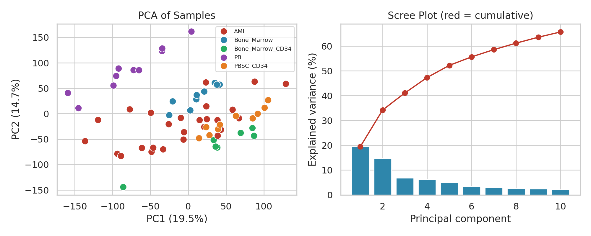
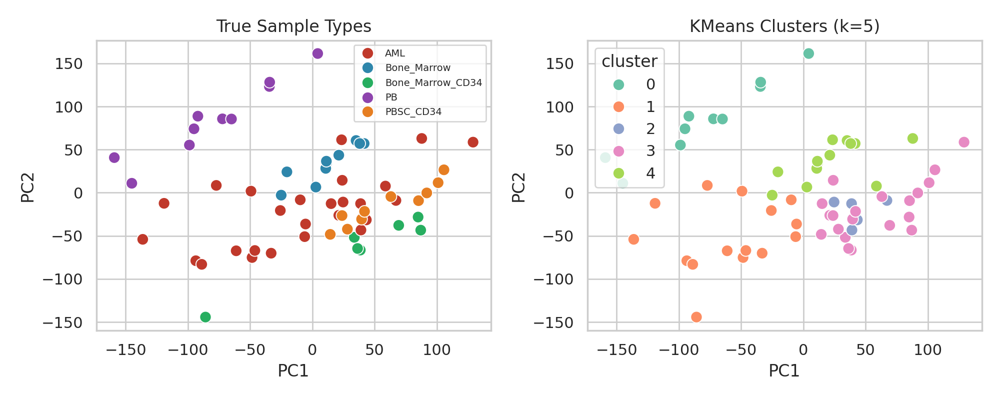
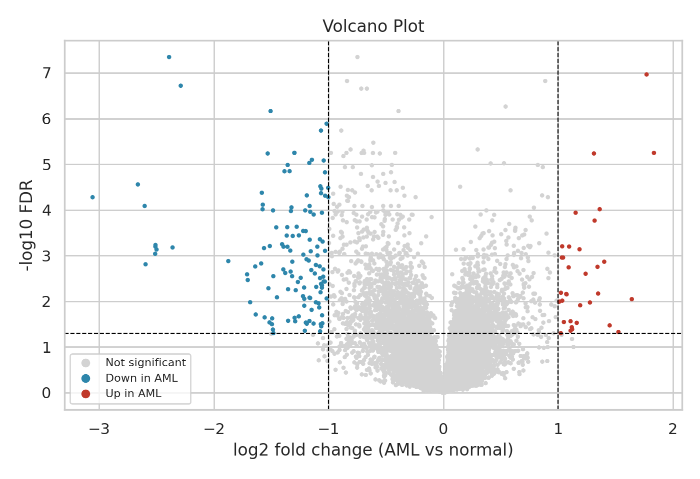
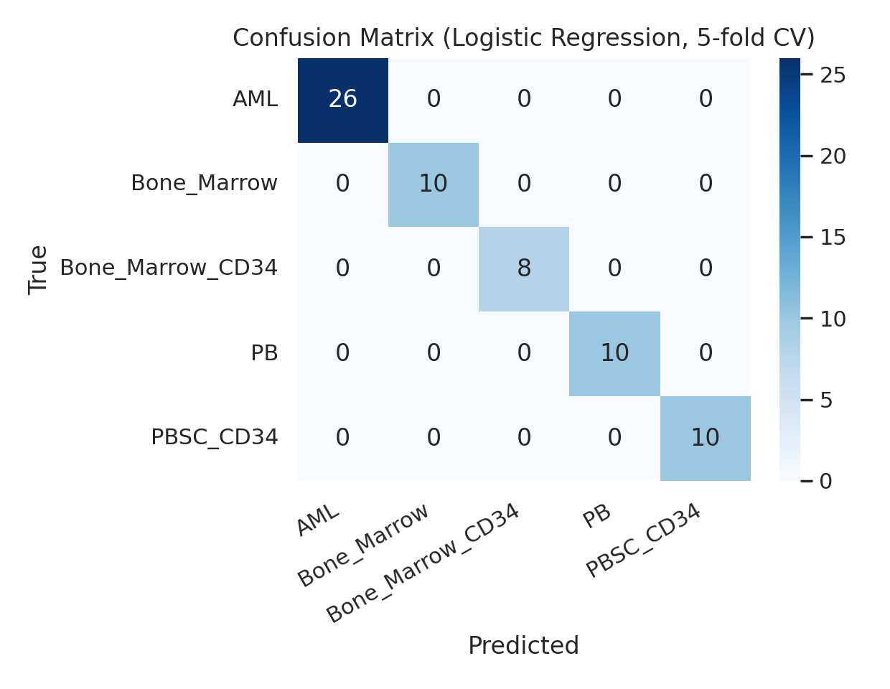

# Decoding Leukemia from Gene Activity

Gene expression analysis of **acute myeloid leukemia (AML)** versus healthy blood and bone marrow cells, using 64 samples and 22,283 gene probes from the public dataset **GEO GSE9476**.

Bioinformatics bootcamp project: *Data Science and Bioinformatics*.

**Author:** Rawan Saad Alshehri

## Links

- Analysis notebook (Google Colab): https://colab.research.google.com/drive/1eMGJh13C1IUsyhyQlT5-GeJojQ6NvRCQ?usp=sharing
- Dataset (Kaggle): https://www.kaggle.com/datasets/brunogrisci/leukemia-gene-expression-cumida
- Original source: NCBI Gene Expression Omnibus, accession GSE9476
- Full report: see the `report/` folder

## Project questions

1. Is the dataset clean and comparable enough for analysis?
2. Do samples naturally group by cell type, based on gene expression alone?
3. Which gene probes differ most between AML and healthy cells?
4. Can a model predict the sample type from gene expression, and how reliable is it?

## Dataset

| Property | Description |
|---|---|
| Samples | 64 |
| Gene probes | 22,283 (Affymetrix microarray) |
| Sample types | AML (26), Bone_Marrow (10), PB (10), PBSC_CD34 (10), Bone_Marrow_CD34 (8) |
| Values | Log-scale expression levels (3.19 to 14.47) |

The data file is not included in this repository. Download it from the Kaggle link above and name it `Leukemia.csv`.

## Methods

- **Data quality:** checks for missing values, duplicates, constant probes, normalization, and outliers (sample-level z-score and the 1.5 x IQR rule).
- **Exploration:** descriptive statistics, correlation of the most variable genes, PCA, KMeans clustering, and similarity between sample types.
- **Differential expression:** Welch t-test per probe (AML vs all healthy samples) with Benjamini-Hochberg FDR correction. Significant means FDR < 0.05 and |log2 fold change| >= 1.
- **Classification:** Logistic Regression and Random Forest with stratified 5-fold cross-validation. The top 500 genes are selected inside each fold to avoid data leakage.

## Key results

- **Data:** complete and clean (no missing values, duplicates, or constant probes). Samples are normalized (median expression 6.22 to 6.44 per sample).
- **Structure:** PCA shows partial separation by type (PC1 19.5%, PC2 14.7%). PB clearly separates, while AML overlaps with several healthy types.
- **Clustering:** KMeans (k = 5) separates PB and Bone_Marrow samples completely, groups the CD34 samples together, and splits AML across four clusters (ARI = 0.44), which suggests heterogeneity within AML.
- **Differential expression:** 163 probes pass the thresholds (33 higher and 130 lower in AML).
- **Prediction:** both models reach 100% accuracy in 5-fold cross-validation.

## Limitations

- Small sample (64) from a single study, with no external validation set.
- Perfect cross-validated accuracy reflects a strong signal in this dataset and may not hold for other laboratories or platforms.
- Probes were not mapped to gene names, and no pathway analysis was done.
- AML was compared with all healthy types pooled together.
- The dataset has no clinical information, so AML subgroups could not be linked to outcomes.

## Next steps

1. Validate the classifier on independent public leukemia datasets.
2. Map probes to gene names and run pathway enrichment analysis.
3. Study AML subgroups using a larger cohort with clinical labels.
4. Test whether a compact gene panel keeps the accuracy.
5. Compare AML with each healthy type separately.

## How to run

1. Open the Colab notebook linked above.
2. Download `Leukemia.csv` from the Kaggle link and upload it when prompted.
3. Run all cells (Runtime, then Run all).

## Tools

Python, pandas, NumPy, SciPy, scikit-learn, matplotlib, seaborn.
